<div align="center">

# Bank Transaction Fraud Detection: Imbalanced-Class Ensembles (XGBoost + LightGBM + Logistic Regression), Isolation Forest Anomaly Scoring, SHAP Explainability and a Label-Leakage Audit

### What happens when a fraud model's near-perfect score is just the label in disguise?
**An end-to-end fraud-detection pipeline on a dirty, 1 %-fraud banking dataset, and the audit that explains why its results look the way they do**


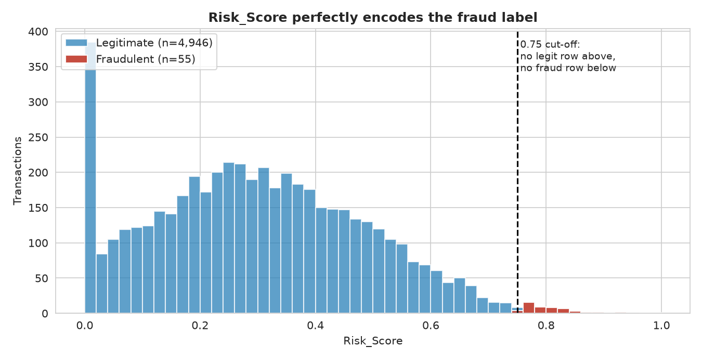

<sub><i>The single most important chart in this repo: one column, <code>Risk_Score</code>, encodes the fraud label perfectly.</i></sub>

</div>

---

## Table of contents

1. [Overview](#overview)
2. [Key findings](#key-findings)
3. [The three model iterations at a glance](#the-three-model-iterations-at-a-glance)
4. [Dataset](#dataset)
5. [Pipeline](#pipeline)
6. [Repository structure](#repository-structure)
7. [Getting started](#getting-started)
8. [Methodology](#methodology)
9. [Results in detail](#results-in-detail)
   - [v1 – Random Forest baseline](#v1--random-forest-baseline)
   - [v2 – XGBoost + Logistic Regression hybrid](#v2--xgboost--logistic-regression-hybrid)
   - [v3 – XGBoost + LightGBM + Logistic Regression, threshold-tuned](#v3--xgboost--lightgbm--logistic-regression-threshold-tuned)
10. [The label-leakage audit](#the-label-leakage-audit)
11. [What the "potentially missed frauds" really are](#what-the-potentially-missed-frauds-really-are)
12. [Explainability: SHAP and feature importance](#explainability-shap-and-feature-importance)
13. [Power BI star-schema export](#power-bi-star-schema-export)
14. [Limitations and methodological caveats](#limitations-and-methodological-caveats)
15. [Recommendations: how I would run this on real data](#recommendations-how-i-would-run-this-on-real-data)
16. [Future work](#future-work)
17. [Troubleshooting](#troubleshooting)
18. [References and credits](#references-and-credits)
19. [Author](#author)

---

## Overview

Fraud detection is the textbook **needle-in-a-haystack** problem: in this dataset only **55 of 5,001 transactions (1.1 %)** are fraudulent, and the raw table is full of the dirt that real banking extracts contain: missing values, numbers stored as text, impossible ages and negative balances.

This project builds a complete, reproducible workflow around that problem:

| Stage | What was done |
|---|---|
| **Data cleaning** | Strip currency symbols and words from money columns, convert text to numbers, impute missing values with medians, parse timestamps |
| **Feature engineering** | 22 features including transaction velocity, deviation from the customer's norm, per-customer frequency, device and location inconsistency, per-customer amount rank |
| **Imbalance handling** | ADASYN oversampling (training split only), class weighting, `scale_pos_weight` |
| **Supervised models** | Random Forest baseline → XGBoost + Logistic Regression → XGBoost + LightGBM + Logistic Regression (weighted soft voting) |
| **Unsupervised signal** | Isolation Forest anomaly score blended with the supervised probability into a **hybrid fraud score** |
| **Threshold tuning** | F1-optimised decision threshold |
| **Explainability** | XGBoost gain importance and SHAP summary plots |
| **BI hand-off** | Star-schema export (2 dimensions + 1 fact) and a flagged-transactions CSV for Power BI |
| **Audit** | A dedicated script that tests the results for label leakage, single-feature signal and flag composition |

The audit is the heart of the repo. The first model scores a perfect 1.000 on every metric. The later, "leak-free" models score at chance. This README explains, with evidence, **why both outcomes happen**, and what that means for anyone building on this kind of data.

> **About the data.** The dataset is **synthetic** (see [Dataset](#dataset) for the evidence). That is why a single column can define the label so neatly. Nothing here describes a real bank's customers or fraud patterns, and the findings about modelling *practice* matter more than the headline metrics.

---

## Key findings

| # | Finding | Evidence |
|:-:|---|---|
| 1 | **`Risk_Score` is the label in disguise.** Every fraud has `Risk_Score` ≥ 0.751; every legitimate transaction has ≤ 0.750 | The rule `Risk_Score > 0.75` reproduces `Is_Fraudulent` for **100 %** of 5,001 rows |
| 2 | The v1 baseline's perfect score is leakage, not skill | Random Forest, stratified 5-fold × 3: ROC-AUC **1.000** with `Risk_Score` vs **0.497** without it |
| 3 | Without `Risk_Score`, **no feature carries signal**; models perform at chance | Single-feature AUCs 0.51–0.57; v2/v3 test ROC-AUC 0.552 / 0.565; cross-validated recall-macro 0.52 / 0.51 (chance = 0.50) |
| 4 | The v3 model's best F1 is **0.034** at a threshold tuned on the test set | 1 of 12 test frauds caught, with 46 false alarms |
| 5 | The hybrid score's "potentially missed frauds" are mostly just Isolation Forest's top 8 % | 400 of 412 flagged rows come from the anomaly flag; the flag itself has AUC **0.5045** against the real label |
| 6 | Dropping `Risk_Score` in v2 (the "no-overfit" versions) was the right call, but the remaining models are fitting noise | The explanations (SHAP, importance) describe what a chance-level model latched onto |
| 7 | The dataset has structural quirks that models silently absorb | One transaction date for all rows (so `Weekday` is constant), 10 distinct first names, 90.7 % of transaction locations differ from the customer's state |

**Bottom line:** the engineering (cleaning, imbalance handling, ensembling, explainability, BI export) is sound and reusable. The *dataset* simply contains no learnable fraud signal beyond the `Risk_Score` that defines it, and the right conclusion is "this data cannot support a fraud model", not "the model reached 56 % AUC".

---

## The three model iterations at a glance

The repo preserves the project's real history, from a baseline to a tuned hybrid. Metrics are from the scripts in `src/`, run with seed 42; raw logs are in [`outputs/logs/`](outputs/logs/).

| | **v1 Baseline** | **v2 Hybrid** | **v3 Tuned hybrid (final)** |
|---|---|---|---|
| Script | `01_baseline_random_forest.py` | `02_ensemble_xgb_logreg.py` | `03_ensemble_xgb_lgbm_logreg_tuned.py` |
| Models | Random Forest | XGBoost + Logistic Regression | XGBoost + LightGBM + Logistic Regression |
| Uses `Risk_Score`? | **Yes** | No | No |
| Data | Pre-cleaned file, rows with bad money values dropped (4,628 rows) | Raw file, median imputation (5,001 rows) | Raw file, median imputation (5,001 rows) |
| Imbalance handling | `class_weight='balanced'` | ADASYN + `scale_pos_weight` | ADASYN + `scale_pos_weight` + `class_weight` |
| Decision threshold | 0.5 (default) | fixed 0.4 | F1-optimal on the test split (0.55) |
| Test-split size / frauds | 926 / 12 | 1,001 / 12 | 1,001 / 12 |
| **Test ROC-AUC** | **1.000** | 0.552 | 0.565 |
| Fraud recall / precision | 12/12 · 1.00 | 6/12 · 0.01 | 1/12 · 0.02 |
| False alarms in test | 0 | 513 | 46 |
| Cross-validated recall-macro (5-fold) | – | 0.523 ± 0.051 | 0.508 ± 0.035 |
| Transactions flagged as "potentially missed fraud" | 0 | 755 | 395 |
| Verdict | **Leakage** | Chance | Chance |

> Re-running gives identical v1 and v3 results to the original project outputs (v3's 395 flagged transactions match exactly). v2's flagged count was 748 in the original run and 755 here, a small difference from newer library versions.

---

## Dataset

| | |
|---|---|
| **File** | `data/raw/complete_dirty_bank_transactions.csv` |
| **Size** | 5,001 transactions · 24 columns · 987 customers (`CUST00001` – `CUST01000`) |
| **Target** | `Is_Fraudulent`: **55 fraud (1.10 %)** · 4,946 legitimate |
| **Time span** | A **single day**: every transaction is stamped 2025-06-15 |
| **Pre-cleaned copy** | `data/processed/cleaned_transactions.csv`: 4,638 rows (363 rows with missing values removed, 2 of them fraud) |

### The data is synthetic

The evidence, all reproducible from the raw file:

- Only **10 distinct first names and 10 distinct last names** across 987 customers; IDs are sequential.
- Categories are near-uniform: gender 35 % / 33 % / 31 %, `Pay_On_Time` 51 % / 49 %, five transaction types at about 20 % each.
- All 5,001 transactions fall on **one date**.
- The fraud label is a **deterministic threshold on `Risk_Score`** (see the [audit](#the-label-leakage-audit)).
- There are no emails, phone numbers or addresses. `Email_Opt_In` is just a boolean.

This makes the data safe to publish and good for teaching, but it also means real-world fraud patterns (geography jumps, merchant categories, burst velocity over days) simply are not present.

### Column groups

| Group | Columns |
|---|---|
| Customer identity | `Customer_ID`, `First_Name`, `Last_Name`, `Gender`, `Age`, `State`, `Join_Date` |
| Account | `Account_Type`, `Account_Balance`, `Credit_Score`, `Account_Age_Years`, `Email_Opt_In` |
| Credit | `Has_Loan`, `Loan_Amount`, `Business_Type`, `Pay_On_Time` |
| Transaction | `Transaction_Type`, `Recent_Transaction_Amount`, `Transaction_Time`, `Transaction_Location`, `Avg_Monthly_Transaction`, `Device_Type` |
| Scores / target | `Risk_Score`, **`Is_Fraudulent`** |

### How "dirty" is it?

<p align="center">
  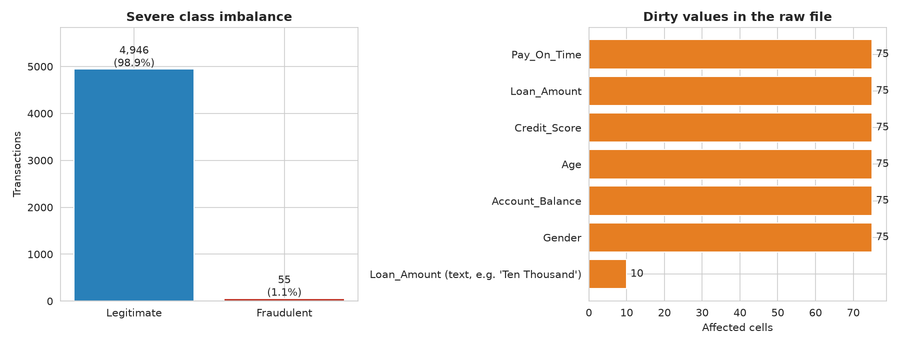
</p>

| Issue | Count | How the pipeline handles it |
|---|--:|---|
| Missing values in `Gender`, `Age`, `Account_Balance`, `Credit_Score`, `Loan_Amount`, `Pay_On_Time` | 75 each (434 rows, 8.7 %, have at least one) | v1: rows dropped · v2/v3: median imputation (numeric) |
| Text in a numeric column (e.g. `"Ten Thousand"` in `Loan_Amount`) | 10 | Becomes `NaN` after symbol stripping, then imputed (the text's meaning is lost) |
| Impossible ages (`Age` > 100, max 150) | 5 | **Not treated** |
| Negative `Account_Balance` (min −1,000) | 5 | **Not treated** |
| `Account_Age_Years` longer than the customer's adult life (`> Age − 18`) | 1,030 rows (20.6 %) | **Not treated** |
| `Has_Loan = False` but `Loan_Amount` populated | 2,418 rows | **Not treated** |
| `Transaction_Location` state ≠ customer `State` | 90.7 % of rows | Becomes `Location_Inconsistency`, which is 1 for ~91 % of rows and so carries almost no information |
| Transactions per customer | 1 – 14 (median 5) | Used for per-customer features |

---

## Pipeline

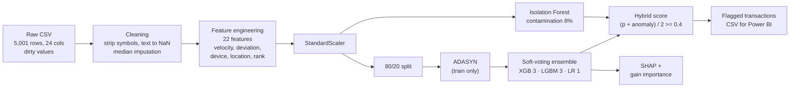

---

## Repository structure

```text
bank-transaction-fraud-detection-ensemble-isolation-forest-shap-leakage-audit/
├── README.md
├── requirements.txt
├── .gitignore
├── src/
│   ├── 00_export_star_schema.py                 ← raw table → dim_customer, dim_account, fact_transaction
│   ├── 01_baseline_random_forest.py             ← v1: Random Forest (uses Risk_Score → leakage)
│   ├── 02_ensemble_xgb_logreg.py                ← v2: XGBoost + Logistic Regression, ADASYN, Isolation Forest
│   ├── 03_ensemble_xgb_lgbm_logreg_tuned.py     ← v3: + LightGBM, F1-tuned threshold, diagnostics  (final)
│   └── 04_data_profile_and_leakage_audit.py     ← data profile + leakage audit
├── data/
│   ├── raw/complete_dirty_bank_transactions.csv
│   ├── processed/cleaned_transactions.csv
│   └── star_schema/                             ← dim_customer.csv, dim_account.csv, fact_transaction.csv
├── outputs/
│   ├── missed_frauds_v1_random_forest.csv       ← header only (0 rows)
│   ├── missed_frauds_v2_xgb_logreg.csv
│   ├── missed_frauds_v3_xgb_lgbm_logreg.csv     ← final flagged-transactions list
│   └── logs/                                    ← captured console output of every script
└── assets/figures/                              ← all charts used in this README
```

---

## Getting started

### 1. Install

```bash
git clone https://github.com/Stephen-Austine/bank-transaction-fraud-detection-ensemble-isolation-forest-shap-leakage-audit.git
cd bank-transaction-fraud-detection-ensemble-isolation-forest-shap-leakage-audit

python -m venv .venv
source .venv/bin/activate            # Windows: .venv\Scripts\activate
pip install -r requirements.txt
```

### 2. Run the scripts

Every script resolves its paths relative to the repo root, so you can run them from anywhere:

```bash
python src/00_export_star_schema.py                    # (optional) Power BI tables
python src/01_baseline_random_forest.py                # v1
python src/02_ensemble_xgb_logreg.py                   # v2
python src/03_ensemble_xgb_lgbm_logreg_tuned.py        # v3 (final) + diagnostic figures
python src/04_data_profile_and_leakage_audit.py        # profile + leakage audit figures
```

Everything runs in **seconds on a laptop CPU**: the dataset is small and no GPU is needed. Figures are written to `assets/figures/` and flagged-transaction CSVs to `outputs/`.

> **Recommended reading order:** start with the [audit](#the-label-leakage-audit), then the three iterations. The audit reframes how every other number should be read.

---

## Methodology

### 1. Cleaning

All money columns (`Loan_Amount`, `Account_Balance`, `Recent_Transaction_Amount`, `Avg_Monthly_Transaction`) go through the same step: remove everything that is not a digit or a decimal point, then convert to numeric. Symbols such as `$` and `,` disappear, and words become `NaN`.

- **v1** then *drops* any row with a missing money value (4,638 → 4,628 rows).
- **v2 / v3** *impute* medians for money columns, `Age` and `Credit_Score`, keeping all 5,001 rows. Rows with an unparseable timestamp would be dropped (none are).

### 2. Feature engineering (v2 / v3: 22 features)

| Feature | Definition |
|---|---|
| **Raw (11)** | `Age`, `Gender`, `Account_Balance`, `Credit_Score`, `Loan_Amount`, `Transaction_Type`, `Pay_On_Time`, `Recent_Transaction_Amount`, `Avg_Monthly_Transaction`, `Device_Type`, `Account_Age_Years` |
| `Hour`, `Weekday` | From `Transaction_Time` (`Weekday` is constant here: one date) |
| `Trans_to_Balance_Ratio` | Transaction amount ÷ (balance + 1) |
| `Trans_Amount_Deviation` | \|amount − monthly average\| ÷ (monthly average + 1) |
| `Trans_Frequency` | Number of transactions by the same customer |
| `Time_Since_Last_Trans` | Hours since the customer's previous transaction (median-filled for the first) |
| `High_Velocity_Flag` | 1 if the previous transaction was less than 30 minutes earlier |
| `Device_Inconsistency_Flag` | 1 if the customer used more than one device type |
| `Location_Inconsistency` | 1 if the transaction state differs from the customer's state |
| `Unusual_Amount_Flag` | 1 if the amount is more than 2.5 standard deviations from the customer's mean |
| `Trans_Amount_Rank` | Rank of the amount within the customer's transactions |

Categorical features are label-encoded and all features are standardised with `StandardScaler`.

### 3. Handling class imbalance

| Technique | Where | Setting |
|---|---|---|
| **ADASYN** | Training split only | `n_neighbors=2` (only 43 frauds in the training split) |
| `scale_pos_weight` | XGBoost | 100 (the actual legit : fraud ratio is ≈ 90 : 1) |
| `class_weight='balanced'` | Logistic Regression, LightGBM, v1 Random Forest | – |

### 4. Models (v3, final)

| Model | Key settings |
|---|---|
| **XGBoost** | 50 trees, depth 4, learning rate 0.05, L2 = 2.0, L1 = 1.0, `scale_pos_weight=100` |
| **LightGBM** | 60 trees, 31 leaves, learning rate 0.05, balanced class weights |
| **Logistic Regression** | L2 penalty, C = 0.05, balanced class weights |
| **Soft-voting ensemble** | Weights **3 : 1 : 3** (XGB : LR : LGBM) on predicted probabilities |
| **Isolation Forest** | `contamination=0.08`, fit on all scaled features |

### 5. The hybrid fraud score

```text
Hybrid score = (ensemble probability + Isolation-Forest flag) / 2        # flag is 0 or 1
Flagged as fraud  ⇔  Hybrid score ≥ 0.4
```

This rule has a consequence worth knowing about: if the Isolation Forest flags a transaction (flag = 1), the score is at least 0.5, **so it is always flagged, whatever the supervised model thinks**. If it does not flag it, the ensemble probability alone must reach **0.8**. The hybrid is therefore close to "Isolation Forest's top 8 %, plus a few very high-probability rows". See [composition](#what-the-potentially-missed-frauds-really-are).

### 6. Threshold selection (v3)

The decision threshold is swept from 0.05 to 0.90 and the F1-maximising value (0.55) is used for the confusion matrix and classification report. In the script this sweep is done **on the test split itself**, which makes the reported test metrics optimistic. With F1 this low it does not change the conclusion, but see the [caveats](#limitations-and-methodological-caveats).

---

## Results in detail

### v1 – Random Forest baseline

Random Forest (100 trees, balanced class weights) on 15 features **including `Risk_Score`**, test split of 926 rows (12 frauds):

```text
Confusion Matrix:                 ROC AUC Score: 1.0
 [[914   0]
  [  0  12]]                      Fraud precision 1.00 · recall 1.00 · F1 1.00
```

A perfect score on a 1 %-fraud dataset should immediately raise suspicion. Because the model flags zero legitimate transactions as fraud, the "missed frauds" export is empty (`outputs/missed_frauds_v1_random_forest.csv` contains only a header). The [audit](#the-label-leakage-audit) shows why.

### v2 – XGBoost + Logistic Regression hybrid

`Risk_Score` is removed. XGBoost and Logistic Regression are combined by soft voting with ADASYN-resampled training data and a fixed 0.4 threshold:

```text
Confusion Matrix:                 ROC AUC Score: 0.552
 [[476 513]
  [  6   6]]                      Fraud precision 0.01 · recall 0.50

Cross-validated recall-macro: 0.523 ± 0.051   (chance = 0.50)
```

The model "finds" half the frauds only by flagging **more than half** of all legitimate transactions (513 of 989), which is the behaviour of a coin flip.

<table>
<tr>
<td width="42%">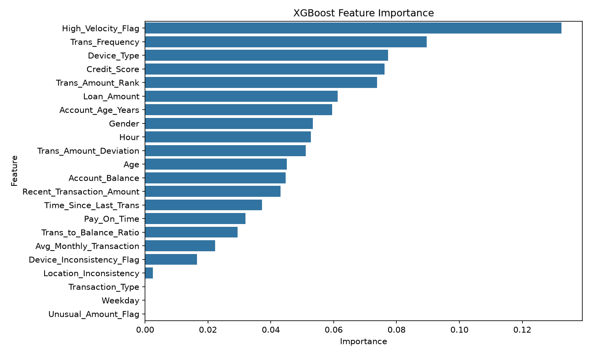</td>
<td width="58%"></td>
</tr>
</table>

### v3 – XGBoost + LightGBM + Logistic Regression, threshold-tuned

LightGBM is added (weights 3 : 1 : 3) and the threshold is tuned for F1 (best = 0.55):

```text
Confusion Matrix:                 ROC AUC Score: 0.565    PR-AUC: 0.017 (no-skill 0.012)
 [[943  46]
  [ 11   1]]                      Fraud precision 0.02 · recall 0.08 · F1 0.034

Cross-validated recall-macro: 0.508 ± 0.035   (chance = 0.50)
```

<table>
<tr>
<td width="50%">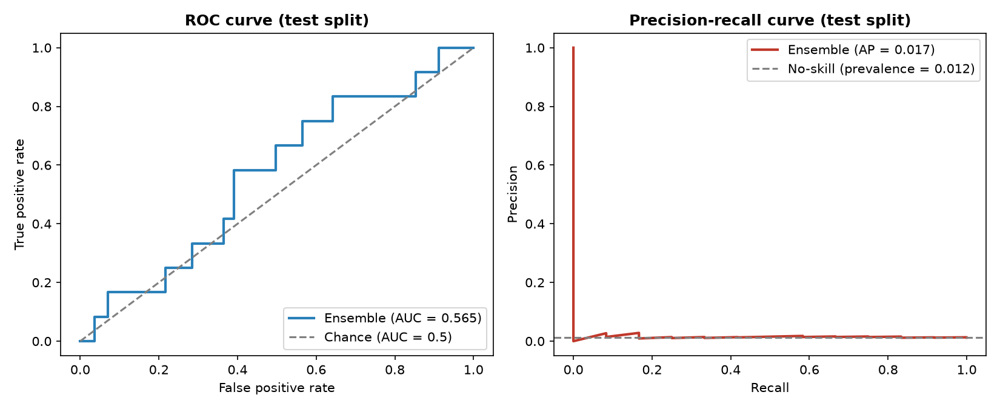</td>
<td width="50%">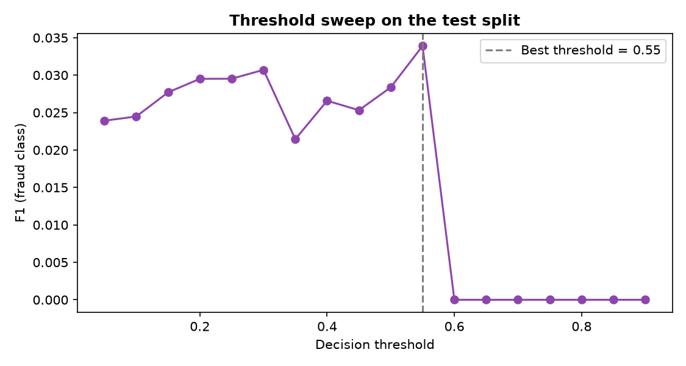</td>
</tr>
</table>

<p align="center">
  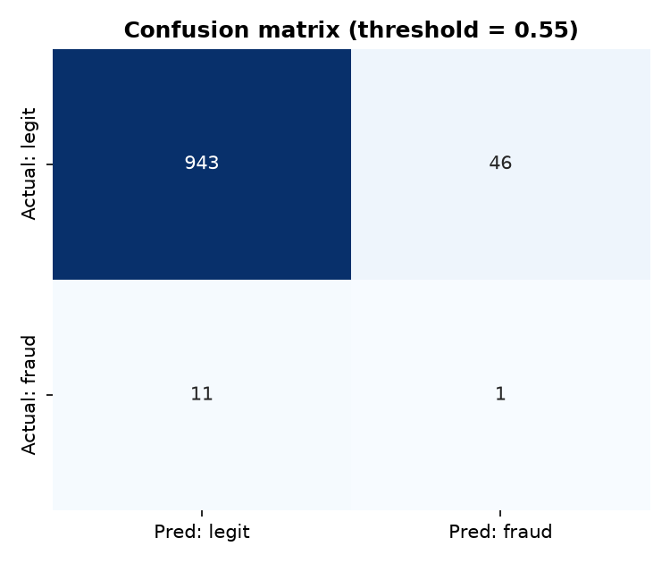
</p>

The ROC curve wanders around the diagonal, and the precision-recall curve sits on the no-skill line. The tiny test set (12 frauds) adds a lot of noise: catching 1 of 12 corresponds to a recall 95 % interval of roughly **1.5 % – 35 %**, so even the modest "improvement" from v2 to v3 is well within noise.

---

## The label-leakage audit

[`src/04_data_profile_and_leakage_audit.py`](src/04_data_profile_and_leakage_audit.py) asks four questions.

### 1. Does one column define the label?

Yes. `Risk_Score` ranges 0–1; frauds all sit at or above **0.751** (median 0.794) and legitimate rows never exceed **0.750**.

| | min | median | max |
|---|--:|--:|--:|
| Legitimate (n = 4,946) | 0.000 | 0.291 | **0.750** |
| Fraudulent (n = 55) | **0.751** | 0.794 | 0.998 |

> The rule `Risk_Score > 0.75` reproduces `Is_Fraudulent` for **100.00 %** of rows (see the headline chart at the top of this README).

### 2. Does any other single feature separate the classes?

<p align="center">
  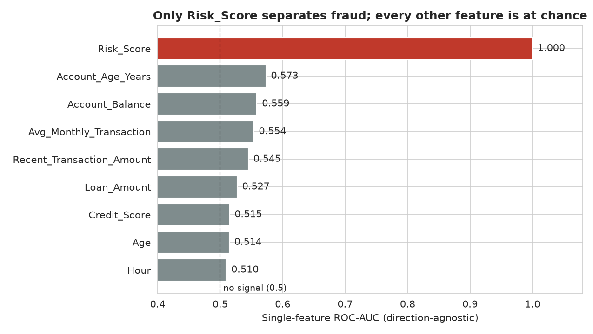
</p>

No. Every other numeric feature has a direction-agnostic AUC between **0.51 and 0.57**, i.e. essentially noise (with only 55 frauds, an AUC of 0.57 is well inside random variation).

### 3. How much of the baseline's performance is `Risk_Score`?

The same Random Forest, run with stratified 5-fold cross-validation repeated 3 times (more reliable than a single split with 12 frauds), on the 4,628-row cleaned data with 53 frauds:

<p align="center">
  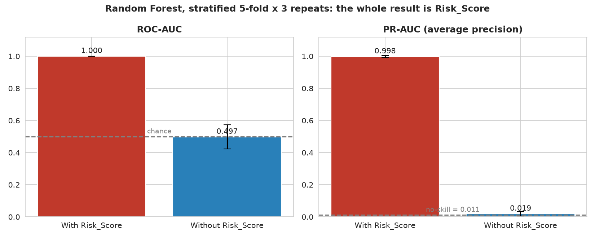
</p>

| Features | ROC-AUC | PR-AUC |
|---|:---:|:---:|
| With `Risk_Score` | **1.000** ± 0.000 | **0.998** ± 0.006 |
| Without `Risk_Score` | 0.497 ± 0.075 | 0.019 ± 0.014 (no-skill = 0.011) |

All of the baseline's performance comes from that one column. Removing it takes ROC-AUC from perfect to a coin flip.

### 4. Is there any signal in the categorical features?

<p align="center">
  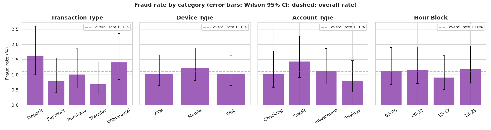
</p>

| Feature | Fraud rate range across categories | Verdict |
|---|---|---|
| Transaction type | 0.69 % (Transfer) – 1.61 % (Deposit) | Every 95 % interval overlaps the overall 1.10 % |
| Device type | 1.03 % – 1.23 % | Indistinguishable |
| Account type | 0.80 % – 1.44 % | Indistinguishable |
| Hour of day (6-hour blocks) | 0.91 % – 1.18 % | Indistinguishable |

### Conclusion of the audit

The fraud label in this dataset is generated from `Risk_Score` alone; everything else is independent noise. Any model that sees `Risk_Score` will be perfect, and any model that does not has nothing to learn. v1's perfect score and v2/v3's chance-level scores are two sides of the same fact.

---

## What the "potentially missed frauds" really are

The scripts export "missed frauds": transactions the bank labelled **legitimate** but the hybrid model flagged as fraud. The idea (finding fraud the bank missed) is a sensible one for real data. Here is what the final model's flags actually consist of:

<p align="center">
  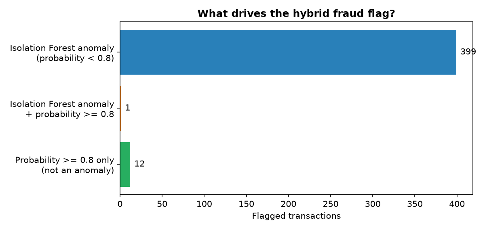
</p>

| Flag source | Transactions |
|---|--:|
| Isolation Forest anomaly (ensemble probability < 0.8) | 399 |
| Isolation Forest anomaly **and** ensemble probability ≥ 0.8 | 1 |
| Ensemble probability ≥ 0.8 only | 12 |
| **Total flagged** | **412** (8.2 % of all rows) |
| of which labelled legitimate → the "potentially missed frauds" export | **395** |

- **97 % of flags come straight from the Isolation Forest**, whose `contamination=0.08` setting forces it to flag the top 8 % of rows (400 of 5,001) by construction.
- The anomaly score has a ROC-AUC of **0.5045** against the real label, so it is **not** more likely to flag frauds than legitimate rows.

<p align="center">
  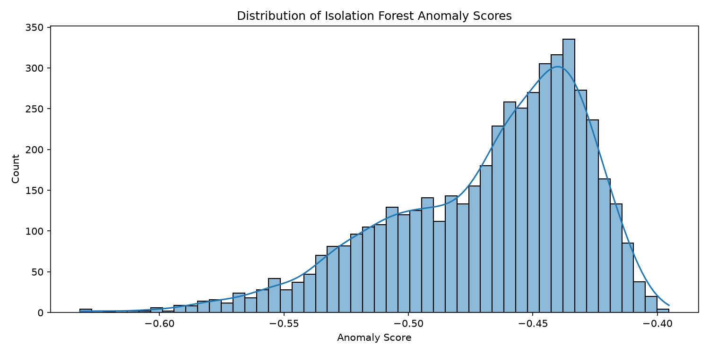
</p>

- The anomaly-score distribution is one smooth, left-skewed hump with no distinct outlier cluster, which is consistent with data generated independently of any anomalous structure.
- The hybrid flag marks 17 of the 55 true frauds, but the supervised half of that is **in-sample**: the model is scored on rows it was trained on.

So the 395-row export is best read as "the most unusual-looking 8 % of normal transactions", not as discovered fraud. On real data with real labels, the same export would be a useful review queue, but it needs genuine evaluation first.

---

## Explainability: SHAP and feature importance

<table>
<tr>
<td width="42%"></td>
<td width="58%">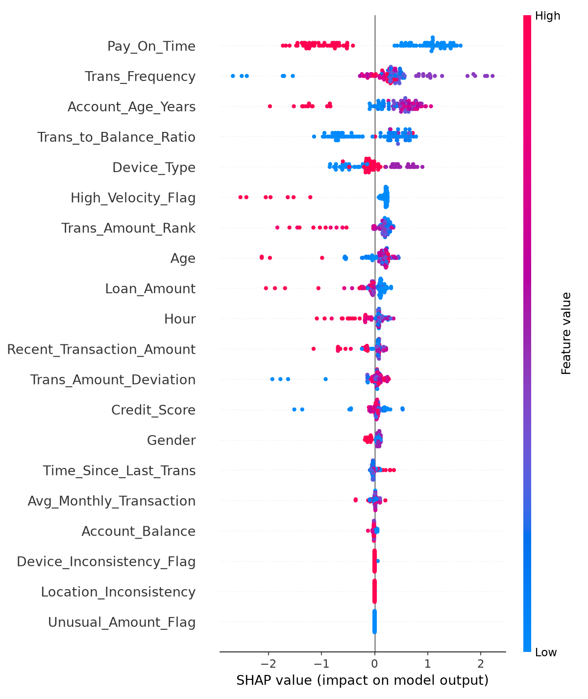</td>
</tr>
</table>

Two views of the same XGBoost model: gain-based importance (left) and a SHAP summary (right).

**How to read them honestly**

- The two views **disagree**: gain importance puts `High_Velocity_Flag`, `Trans_Frequency` and `Device_Type` on top, while SHAP ranks `Pay_On_Time` first. Disagreement like this is typical when a model has no stable signal to agree on.
- The SHAP values are computed on **only the first 100 rows**. Because the table is sorted by customer, those rows belong to only 18 customers, which is why per-customer attributes such as `Pay_On_Time` form two tidy clusters.
- `Weekday`, `Transaction_Type` and `Unusual_Amount_Flag` have **zero** gain importance (`Weekday` is constant; the unusual-amount flag never fires).
- Explaining a chance-level model tells you **what it fitted**, not what causes fraud. The explainability tooling itself (SHAP integration, plotting, export) is reusable, and valuable once the underlying model has real signal.

---

## Power BI star-schema export

`src/00_export_star_schema.py` splits the raw table into a star schema for dashboarding:

| Table | Rows | Columns |
|---|--:|---|
| `fact_transaction` | 5,001 | `Customer_ID`, `Transaction_Time`, `Transaction_Type`, `Recent_Transaction_Amount`, `Transaction_Location`, `Avg_Monthly_Transaction`, `Device_Type`, `Account_Age_Years`, `Risk_Score`, `Is_Fraudulent` |
| `dim_customer` | 4,275 | `Customer_ID`, `First_Name`, `Last_Name`, `Gender`, `Age`, `State`, `Join_Date`, `Has_Loan`, `Loan_Amount`, `Business_Type`, `Pay_On_Time` |
| `dim_account` | 1,133 | `Customer_ID`, `Account_Type`, `Account_Balance`, `Credit_Score` |

The flagged-transactions CSV (`outputs/missed_frauds_v3_xgb_lgbm_logreg.csv`, 395 rows, 43 columns including `Anomaly_Score`, `Ensemble_Prediction` and `Hybrid_Fraud_Score`) can be loaded alongside these tables.

> ⚠️ **Modelling note for BI use.** The "dimension" tables are *not* unique on `Customer_ID`: there are 987 customers but 4,275 `dim_customer` rows. The cause is that `Loan_Amount`, `Business_Type` and `Pay_On_Time` **vary from transaction to transaction** for the same customer (in 49 %, 92 % and 83 % of customers respectively), so `drop_duplicates()` keeps one row per distinct combination. In Power BI this produces many-to-many relationships. Either move those three columns into the fact table, or aggregate them per customer before building the dimension.

---

## Limitations and methodological caveats

These are the things I would flag in a code review of this project, in rough order of importance.

1. **Label leakage in v1.** `Risk_Score` defines the target, so v1's 1.000 means nothing. (Dropping it in v2/v3 was the correct instinct, and this repo documents why.)
2. **No learnable signal remains.** With `Risk_Score` removed, every feature is at chance, so v2/v3 metrics reflect noise.
3. **Tiny evaluation set.** The test split has **12 frauds**. One more or fewer caught shifts recall by 8 points. Confidence intervals are very wide, and single-split numbers should not be compared at the second decimal.
4. **Threshold tuned on the test split.** In v3, the F1-optimal threshold is chosen using the same test data that is then used to report F1, which inflates the number. A separate validation split or cross-validated threshold selection is needed.
5. **Scaling before splitting.** `StandardScaler` is fitted on all rows before the train/test split, so test-set statistics leak into preprocessing (a mild effect, but avoidable with a `Pipeline`).
6. **Row-level split with customer-level features.** The same customer appears in both train and test (about 5 transactions each), and features such as `Trans_Frequency`, `Device_Inconsistency_Flag`, `Trans_Amount_Rank` and the unusual-amount statistics are computed over *all* of a customer's rows, including test rows. A customer-grouped split (`GroupKFold`) is the right design.
7. **Hybrid score dominated by `contamination`.** As shown above, the rule `(p + flag) / 2 ≥ 0.4` makes the Isolation Forest's 8 % quota decide most flags. The count of "missed frauds" is effectively a function of that hyper-parameter.
8. **"Missed fraud" is not validated.** A legitimate-labelled transaction flagged by a model is only a *candidate*. Without investigator feedback there is no way to know whether any is truly fraud, and on this dataset the flag is no better than random.
9. **Flag precision is measured in-sample.** The hybrid is applied to all 5,001 rows, including the rows the supervised models were trained on.
10. **SHAP on 100 unrepresentative rows**, computed on a model with no signal (see above).
11. **Cleaning limitations.** Text such as "Ten Thousand" is discarded rather than parsed; impossible ages, negative balances and logical inconsistencies are left untouched; the minus sign is stripped from money columns by the regex; and medians are computed on all rows.
12. **ADASYN with `n_neighbors=2`** on 43 positives generates synthetic fraud points from very few neighbours. This is a reasonable stop-gap but unstable, and oversampling cannot create signal that is not there.
13. **Single seed, no repeated experiments** for v2 and v3. The audit script uses repeated stratified CV for the key comparison.
14. **Synthetic data.** Patterns here (one day, 10 names, uniform categories) do not resemble real transaction logs. Treat the pipeline as a template, not a validated fraud system.

---

## Recommendations: how I would run this on real data

| Concern | Do this instead |
|---|---|
| Leakage | Treat any provided score (like `Risk_Score`) as a possible label proxy: test its single-feature AUC *first*, and exclude anything that would not exist at prediction time |
| Evaluation | Report **PR-AUC** and recall at a fixed false-positive budget, with confidence intervals; stop relying on accuracy or ROC-AUC alone at 1 % prevalence |
| Splitting | Use a **time-based** split (train on earlier days, test on later) and **customer-grouped** folds |
| Preprocessing | Put scaling, imputation, encoding and ADASYN **inside** a single `imblearn.Pipeline` so each CV fold is fitted only on its own training data |
| Threshold | Select it on a validation set or by cross-validation, based on investigation capacity (alerts per day), not F1 |
| Anomaly detection | Choose `contamination` from the expected alert budget, evaluate the anomaly score against labels, and combine it with a rank-based or calibrated rule rather than `(p + flag) / 2` |
| Explainability | Compute SHAP on a **random, representative sample** of held-out rows |
| Data | Validate against a real fraud dataset (for example, the public IEEE-CIS Fraud Detection or ULB credit-card fraud datasets) before drawing conclusions |

---

## Future work

- [ ] Rebuild the evaluation with a single `imblearn.Pipeline`, **customer-grouped** stratified CV and **PR-AUC** as the primary metric.
- [ ] Add a leakage check to the pipeline itself (automatically flag any feature with single-feature AUC above 0.95).
- [ ] Fix the cleaning step: parse number words, cap or flag impossible ages/balances, and reconcile `Has_Loan` with `Loan_Amount`.
- [ ] Repair the star schema so the dimension tables are unique on `Customer_ID`, and publish the Power BI report.
- [ ] Replace the `(p + flag) / 2` rule with a rank-based combination, and tune the alert budget instead of `contamination`.
- [ ] Apply the same pipeline to a **real** public fraud dataset to see which techniques actually earn their keep.
- [ ] Calibrate the ensemble probabilities (isotonic / Platt) and add cost-sensitive evaluation.
- [ ] Add unit tests for the feature-engineering functions and a CI workflow.

---

## Troubleshooting

| Problem | Fix |
|---|---|
| `ModuleNotFoundError` (e.g. `xgboost`, `lightgbm`, `shap`, `imblearn`) | `pip install -r requirements.txt` in your active environment |
| `lightgbm` fails to import on macOS (`libomp`) | `brew install libomp` |
| `Parameters: { "use_label_encoder" } are not used` | Harmless warning from newer XGBoost versions; the option is ignored |
| v2's flagged-transaction count is not exactly 748 | Expected: it depends slightly on library versions (v3 reproduces exactly: 395) |
| Figures overwritten after re-running | The scripts regenerate everything in `assets/figures/`; this is intentional |
| SHAP is slow or memory-hungry | The script only explains 100 rows, so this should not happen; check you have not changed `X_scaled[:100]` |
| `FileNotFoundError` for the CSV | Run from any directory, but keep the repo layout intact (`data/raw/…`); paths are resolved relative to the repo root |

---

## References and credits

- T. Chen and C. Guestrin, *XGBoost: A Scalable Tree Boosting System*, KDD 2016.
- G. Ke et al., *LightGBM: A Highly Efficient Gradient Boosting Decision Tree*, NeurIPS 2017.
- H. He, Y. Bai, E. Garcia and S. Li, *ADASYN: Adaptive Synthetic Sampling Approach for Imbalanced Learning*, IJCNN 2008.
- F. T. Liu, K. M. Ting and Z.-H. Zhou, *Isolation Forest*, ICDM 2008.
- S. Lundberg and S.-I. Lee, *A Unified Approach to Interpreting Model Predictions* (SHAP), NeurIPS 2017.
- G. Lemaître, F. Nogueira and C. Aridas, *Imbalanced-learn: A Python Toolbox to Tackle the Curse of Imbalanced Datasets in Machine Learning*, JMLR 2017.
- Built with [scikit-learn](https://scikit-learn.org/), [XGBoost](https://xgboost.ai/), [LightGBM](https://lightgbm.readthedocs.io/), [SHAP](https://shap.readthedocs.io/), [imbalanced-learn](https://imbalanced-learn.org/), [pandas](https://pandas.pydata.org/), [Matplotlib](https://matplotlib.org/) and [Seaborn](https://seaborn.pydata.org/).
- **Dataset:** a synthetic, deliberately dirty bank-transactions table supplied with the project. If you reuse it, credit its original source and check its terms.

---

## Author

**Stephen Austine** ([@Stephen-Austine](https://github.com/Stephen-Austine))
Data science · machine learning · AI engineering, Nairobi, Kenya

Feedback, issues and pull requests are welcome.
# bank-transaction-fraud-detection-ensemble-isolation-forest-shap-leakage-audit
